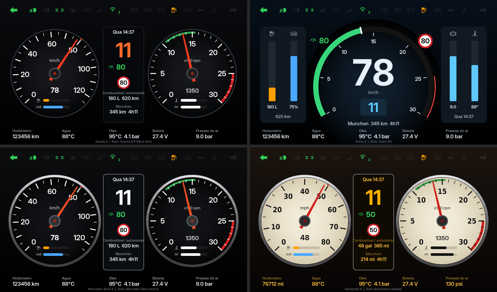

# TruckDash (TD)

**Painel de instrumentos do Euro Truck Simulator 2 e do American Truck Simulator num tablet ou celular Android, inclusive aparelhos antigos.**

O TD lê a telemetria do jogo e mostra, num Android ao lado do volante, o painel do caminhão que você está dirigindo. O app escolhe o painel sozinho pela marca do caminhão.



## Ampla compatibilidade

A ideia do TD é aproveitar o aparelho que está parado na gaveta. Por isso ele foi feito para rodar em quase tudo:

| | Compatibilidade |
|---|---|
| **Android** | Do **2.3 (Gingerbread) ao 13**. Feito e pensado para o **Android 4** |
| **Processador** | **ARM 32 bits (armeabi-v7a)** e **Intel/AMD x86**, ou seja, a grande maioria dos tablets e celulares antigos. Aparelhos ARM 64 bits que rodam apps de 32 bits também funcionam |
| **Aparelho fraco** | O app é **nativo (C)**, sem Java e sem OpenGL: desenha tudo por software. Roda em tablets baratos, com pouca memória e GPU fraca |
| **Tela** | **Qualquer resolução e proporção** (4:3, 16:10, 16:9...). O painel se ajusta sozinho e fica sempre na horizontal |
| **Jogos** | **Euro Truck Simulator 2** e **American Truck Simulator** (Windows 64 bits), por meio do SDK oficial de telemetria da SCS (versões 1.00 e 1.01) |
| **Windows** | 7, 8, 10 e 11, de 64 bits |
| **Conexão** | **Wi‑Fi automático** (sem configurar nada), **IP manual** (quando PC e tablet estão em redes diferentes), **cabo USB via ADB** ou **ancoragem USB** |
| **Outros plugins** | Funciona junto com SimHub, FanaLEDs e outros plugins de telemetria |
| **Unidades** | Automáticas: km/h, km, litros e bar no ETS2; mph, milhas, galões e psi no ATS |
| **Instalação** | Sem licença, sem conta, sem Google Play e sem programa servidor no PC. Só a DLL no jogo e o APK no tablet |

## Painéis originais do jogo (novo)

O TD consegue mostrar **o mesmo painel digital que aparece dentro da cabine no jogo**: Volvo FH 2021 e 2024, Scania S/R 2016, Scania 2025, Scania S 2024e, DAF 2021 e XD, DAF XF, MAN TGX 2020, Iveco S-Way, Renault T, Mercedes Actros e outros, cerca de 30 modelos. Cada um tem as várias telas que o caminhão real oferece.

Para isso existe um **interpretador do formato de painéis da SCS**, os arquivos `ui/dashboard/*.sii`:
- mesmo layout, cores e fontes SDF do jogo;
- barras, ponteiros e ícones ligados aos IDs oficiais (velocidade 1020, rpm 1700, piloto automático 1240...);
- escolha automática do painel pelo modelo do caminhão.

O conversor `tools/tdpack.py` transforma os arquivos extraídos do **seu** jogo em pacotes `.tdp`, que vão para `TruckDash/paineis/` no tablet. **Os pacotes contêm arte da SCS e são só para uso pessoal; por isso não estão neste repositório.**

| Toque | O que faz |
|---|---|
| Toque curto (painel original) | Passa para a próxima tela do painel |
| Toque longo (0,7 s) | Alterna entre o painel original e os painéis do TruckDash |
| Toque curto (painéis do TruckDash) | Troca o tema (Automático → Scania → Volvo → ...) |

## Painéis do TruckDash

Se não houver painel original para o caminhão, por exemplo em mods ou nos americanos, entram os 10 painéis próprios do TD, escolhidos automaticamente pela marca do caminhão. Também dá para fixar um tocando na tela.

- Scania S/R (nova geração) e Scania R/Streamline
- Volvo FH
- Mercedes-Benz Actros
- MAN TGX
- DAF XF
- Renault Trucks T
- Iveco S-Way
- Americanos clássicos (Kenworth, Peterbilt, Mack, Western Star)
- Genérico, para as demais marcas e mods

**O que aparece no painel:**
- velocímetro e conta-giros, com faixa econômica e faixa vermelha no limite do motor
- marcha, piloto automático e placa de limite de velocidade
- combustível com autonomia, AdBlue e pressão do ar
- temperatura da água e do óleo, pressão do óleo e bateria
- hodômetro, GPS (distância, tempo e destino) e relógio do jogo
- luzes do painel: setas, faróis, lanternas, giroflex, diferencial, eixo levantado, retarder com o nível, freio motor, freio de estacionamento e alertas

## Como instalar

Os arquivos prontos ficam na pasta [`releases/`](releases/).

1. **PC:** baixe `releases/TruckDash.dll` e os arquivos da pasta [`pc/`](pc/) para uma mesma pasta, e rode `Instalar-plugin.bat`. Ele acha o jogo na Steam e copia o plugin. Se preferir, copie a DLL você mesmo para `...\bin\win_x64\plugins\`.
2. **Tablet:** ative "Fontes desconhecidas" e instale `releases/TruckDash.apk`. Se der erro ao analisar o pacote, use `TruckDash-sem-icone.apk`.
3. **Abra o jogo** com o app aberto no tablet.

**Pelo cabo USB:**
1. Ative a "Depuração USB" no tablet.
2. Extraia o [platform-tools](https://developer.android.com/tools/releases/platform-tools) do Android na mesma pasta do `TruckDash-USB.bat`.
3. Rode `TruckDash-USB.bat` e deixe a janela aberta enquanto joga.

**PC e tablet em redes Wi‑Fi diferentes:**
- crie um `TruckDash.txt` com o IP do tablet ao lado da DLL, na pasta `plugins`; ou
- crie um `truckdash.txt` com o IP do PC na raiz do armazenamento do tablet.

## Como funciona

```
ETS2/ATS ──SDK de telemetria──> TruckDash.dll ──UDP (Wi‑Fi) ou TCP (USB/adb)──> app Android
```

- **Plugin (`plugin/`):** DLL em C puro, sem dependências. Registra os canais do SDK da SCS e envia um pacote binário de cerca de 400 bytes 25 vezes por segundo.
  - Pelo **Wi‑Fi**, manda por broadcast para a rede local (porta 45455) e direto para os tablets que se anunciaram (porta 45454).
  - Pelo **cabo**, usa TCP em `127.0.0.1:45456`, que o `adb forward` leva até o tablet.
- **Protocolo (`common/td_proto.h`):** uma estrutura fixa com velocidade, rpm, marcha, fluidos, luzes e a marca e o modelo do caminhão. É pela marca que o app troca de painel.
- **App (`android/`):** `NativeActivity` em C, sem nenhuma linha de Java. Tem um renderizador por software com suavização de bordas e fontes pré-renderizadas. A rede roda em threads separadas.
- **Build (`tools/`, `build_all.sh`):** o APK é montado **sem Android SDK nem NDK**, só com:
  - `clang` e `lld`, compilando contra bibliotecas "falsas" só para resolver os símbolos;
  - um gerador próprio do `AndroidManifest.xml` binário e do `resources.arsc`;
  - assinatura v1 (SHA1), que o Android 4 aceita.
- **Painéis originais (`android/scsdash.c`, `tools/tdpack.py`, `tools/tdpreview.py`):** o conversor lê as definições do painel (`.sii`), as texturas (`.dds`) e as fontes SDF do jogo e gera um pacote compacto. O app interpreta esse pacote com o mesmo algoritmo de layout da prévia em Python. O fundo fica em cache; a cada quadro só os elementos que mudam são redesenhados.
- **Testes (`test/`):** um "jogo falso", que carrega o plugin e simula a telemetria, e um "tablet falso", que roda o app no Linux e salva os quadros como imagem.

## Compilar

Num Linux com `clang`, `lld`, `python3` + Pillow e um JDK (para o `jarsigner`):

```sh
./build_all.sh      # gera out/TruckDash.dll, out/TruckDash.apk e out/TruckDash-sem-icone.apk
```

## Aprendizado

Este repositório também acompanha o que aprendi nos meus projetos. O diário do TD está em [`docs/aprendizado.md`](docs/aprendizado.md).

---
Projeto pessoal, sem fins comerciais. Euro Truck Simulator 2 e American Truck Simulator são marcas da SCS Software. As marcas de caminhões citadas pertencem aos seus donos e servem apenas para identificar o estilo de cada painel.
