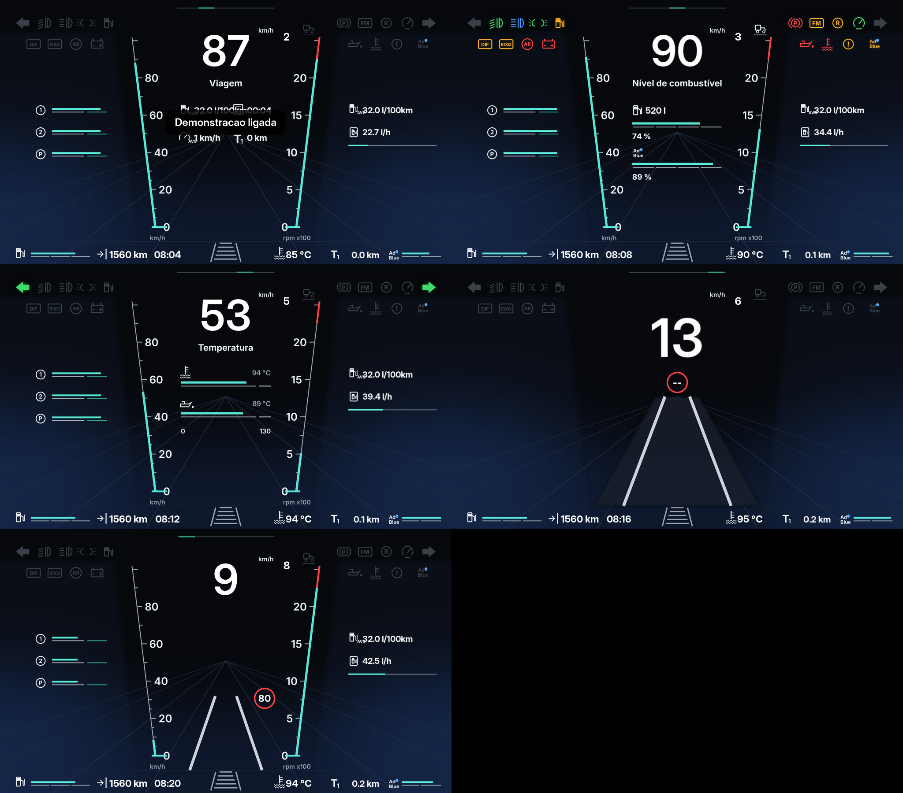

# TruckDash (TD)

**Painel de instrumentos do Euro Truck Simulator 2 e do American Truck Simulator num tablet ou celular Android, inclusive aparelhos antigos.**

O TD lê a telemetria do jogo e mostra, num Android ao lado do volante, um painel **Scania Smart Dash** montado com imagens PNG que você mesmo pode trocar.



*Arte desenhada do zero por `tools/gen_scania_smart_dash.py`, seguindo a disposição do painel digital da Scania. Não inclui o logotipo da marca.*

## Ampla compatibilidade

A ideia do TD é aproveitar o aparelho que está parado na gaveta. Por isso ele foi feito para rodar em quase tudo:

| | Compatibilidade |
|---|---|
| **Android** | Do **2.3 (Gingerbread) ao 13**. Feito e pensado para o **Android 4** |
| **Processador** | **ARM 32 bits (armeabi-v7a)** e **Intel/AMD x86**, ou seja, a grande maioria dos tablets e celulares antigos. Aparelhos ARM 64 bits que rodam apps de 32 bits também funcionam |
| **Aparelho fraco** | O app é **nativo (C)**, sem Java e sem OpenGL: desenha tudo por software. Roda em tablets baratos, com pouca memória e GPU fraca |
| **Tela** | **Qualquer resolução e proporção** (4:3, 16:10, 16:9...). O painel se ajusta sozinho e fica sempre na horizontal |
| **Jogos** | **Euro Truck Simulator 2** e **American Truck Simulator** (Windows 64 bits), por meio do SDK oficial de telemetria da SCS (versões 1.00 e 1.01) |
| **Windows** | 7, 8, 10 e 11, de 64 bits |
| **Conexão** | **Wi‑Fi automático** (sem configurar nada), **IP manual** (quando PC e tablet estão em redes diferentes), **cabo USB via ADB** ou **ancoragem USB** |
| **Outros plugins** | Funciona junto com SimHub, FanaLEDs e outros plugins de telemetria |
| **Unidades** | Automáticas: km/h, km, litros e bar no ETS2; mph, milhas, galões e psi no ATS |
| **Instalação** | Sem licença, sem conta, sem Google Play e sem programa servidor no PC. Só a DLL no jogo e o APK no tablet |

## Painel por camadas PNG

O painel é uma pasta (`TruckDash/scania-smart-dash/` no tablet) com imagens e um arquivo de texto:

- `fundo.png`: o painel inteiro apagado;
- para cada luz ou botão, **um PNG aceso e um PNG apagado**;
- `painel.txt`: liga cada PNG a um dado do jogo e posiciona números, barras, arcos e ponteiros.

```
fundo fundo.png
luz seta_esq  on=seta_esq_on.png  off=seta_esq_off.png
arco rpm img=rpm_cheio.png cx=250 cy=250 de=0 ang_de=-135 ate=2500 ang_ate=135
barra combustivel img=combustivel_cheio.png de=0 ate=100 sentido=direita
ponteiro velocidade img=ponteiro.png cx=1030 cy=250 de=0 ang_de=-135 ate=120 ang_ate=135
texto velocidade x=640 y=250 altura=130 cor=FFFFFF alinha=centro fonte=negrito
```

**Por que é leve:** o fundo e todas as luzes apagadas são fundidos numa imagem só, já na resolução da tela, e copiados a cada quadro. Por cima entra apenas o que está ligado. As camadas podem ser exportadas no tamanho do painel inteiro: o app corta as bordas transparentes sozinho, então não é preciso informar posições.

A referência completa do formato está em [`docs/painel-png.md`](docs/painel-png.md).

**Telas em carrossel:** a linha `tela 1 2 3` faz os itens seguintes aparecerem só nessas telas; `tela todas` volta para todas. O painel vem com 5 telas: principal, viagem, combustível, temperatura e só velocidade.

| Toque | O que faz |
|---|---|
| Toque curto na metade direita | Próxima tela |
| Toque curto na metade esquerda | Tela anterior |
| Toque longo (0,7 s) à esquerda | Recarrega o `painel.txt` e os PNGs |
| Toque longo (0,7 s) à direita | Liga ou desliga a demonstração, que anima o painel sem o jogo |

## Como instalar

Os arquivos prontos ficam na pasta [`releases/`](releases/).

1. **PC:** baixe `releases/TruckDash.dll` e os arquivos da pasta [`pc/`](pc/) para uma mesma pasta, e rode `Instalar-plugin.bat`. Ele acha o jogo na Steam e copia o plugin. Se preferir, copie a DLL você mesmo para `...\bin\win_x64\plugins\`.
2. **Tablet:** ative "Fontes desconhecidas" e instale `releases/TruckDash.apk`. Se der erro ao analisar o pacote, use `TruckDash-sem-icone.apk`.
3. **Painel:** copie a pasta do painel para `/sdcard/TruckDash/scania-smart-dash/` no tablet. Para gerar: `python3 tools/gen_scania_smart_dash.py pasta`.
4. **Abra o jogo** com o app aberto no tablet.

**Pelo cabo USB:**
1. Ative a "Depuração USB" no tablet.
2. Extraia o [platform-tools](https://developer.android.com/tools/releases/platform-tools) do Android na mesma pasta do `TruckDash-USB.bat`.
3. Rode `TruckDash-USB.bat` e deixe a janela aberta enquanto joga.

**PC e tablet em redes Wi‑Fi diferentes:**
- crie um `TruckDash.txt` com o IP do tablet ao lado da DLL, na pasta `plugins`; ou
- crie um `truckdash.txt` com o IP do PC na raiz do armazenamento do tablet.

## Como funciona

```
ETS2/ATS ──SDK de telemetria──> TruckDash.dll ──UDP (Wi‑Fi) ou TCP (USB/adb)──> app Android
```

- **Plugin (`plugin/`):** DLL em C puro, sem dependências. Registra os canais do SDK da SCS e envia um pacote binário de cerca de 400 bytes 25 vezes por segundo.
  - Pelo **Wi‑Fi**, manda por broadcast para a rede local (porta 45455) e direto para os tablets que se anunciaram (porta 45454).
  - Pelo **cabo**, usa TCP em `127.0.0.1:45456`, que o `adb forward` leva até o tablet.
- **Protocolo (`common/td_proto.h`):** uma estrutura fixa com velocidade, rpm, marcha, fluidos, luzes e a marca e o modelo do caminhão. 
- **App (`android/`):** `NativeActivity` em C, sem nenhuma linha de Java. Tem um renderizador por software com suavização de bordas e fontes pré-renderizadas. A rede roda em threads separadas.
- **Build (`tools/`, `build_all.sh`):** o APK é montado **sem Android SDK nem NDK**, só com:
  - `clang` e `lld`, compilando contra bibliotecas "falsas" só para resolver os símbolos;
  - um gerador próprio do `AndroidManifest.xml` binário e do `resources.arsc`;
  - assinatura v1 (SHA1), que o Android 4 aceita.
- **Painel (`android/skin.c`):** decodificador de PNG próprio (usa só a zlib do sistema), redimensionamento único para a resolução da tela e desenho por camadas: luzes, barras e arcos revelados por recorte, ponteiros girados e números.
- **Testes (`test/`):** um "jogo falso", que carrega o plugin e simula a telemetria, e um "tablet falso", que roda o app no Linux e salva os quadros como imagem.

## Compilar

Num Linux com `clang`, `lld`, `python3` + Pillow e um JDK (para o `jarsigner`):

```sh
./build_all.sh      # gera out/TruckDash.dll, out/TruckDash.apk e out/TruckDash-sem-icone.apk
```

## Aprendizado

Este repositório também acompanha o que aprendi nos meus projetos. O diário do TD está em [`docs/aprendizado.md`](docs/aprendizado.md).

---
Projeto pessoal, sem fins comerciais. Euro Truck Simulator 2 e American Truck Simulator são marcas da SCS Software. Scania e Smart Dash são marcas da Scania; este projeto não tem ligação com a fabricante.
